# EECS3311 Course Project: Stage 1 Design Report

## AccessFix: an AI agent that audits and repairs web accessibility issues

| Item | Details |
|---|---|
| Student | _Dhruv Arora,219002260_ |

---

## Task 1: Define the agent project

### 1.1 Project description

**Problem.** Many websites contain barriers that stop disabled people from using them, such as images with no text alternative, unlabelled form fields, and links or buttons with no name. Automated checkers list these problems, but developers still have to work out what each one means, which matter most and how to fix them. Good fixes often need judgement: a checker can say an image has no alt text, but not what the alt text should say.

**Target users.**

| User | What they need |
|---|---|
| Front-end developers | Find and fix issues in their pages, and review fixes before accepting them. |
| QA testers | Run repeatable audits and export reports. |
| Content authors | Understand issues in plain language and get help writing alt text and labels. |
| Students learning accessibility | Learn which WCAG success criteria apply and why. |

**What the agent can do.** AccessFix loads a page from a URL or an HTML file, stores a snapshot of it and scans the snapshot with a deterministic rule engine. The agent explains the issues, plans the work and fixes the issues it can fix safely. Every fix is re-scanned. A fix that doesn't resolve its issue, or that creates a new one, is undone automatically. Issues the agent can't fix are escalated to the user. The agent has three modes:

| Mode | Purpose | Can it change the page? |
|---|---|---|
| Ask | Answer questions about the audit. | No. It only has read-only tools. |
| Plan | Produce a ranked remediation plan. | No. Our code validates the plan it submits. |
| Fix | Propose fixes for the user to approve. | Yes, but only allowed fix types, and only after the user approves. |

**Why an AI agent is appropriate.**

- **Fixes need judgement.** Writing alt text and labels, and deciding priorities for a particular page, are language and reasoning tasks.
- **The work is multi-step.** The model decides which tool to call next, which fix to try, whether to retry and when to escalate. Each choice depends on the previous result.
- **Results can be checked.** The model proposes, and the rule engine checks. This keeps the agent's behaviour testable.

**AI model.** Claude Opus 5.5 (`claude-opus-5-5`), called through the Anthropic Java SDK. The system uses tool use, image input (for alt text) and structured outputs (for explanations and alt text).

**How the AI model interacts with the rest of the system.** The model never changes the page directly. It acts only through tools that our code defines, checks and runs:

1. `AgentController` sends Claude the current mode's instructions, the conversation so far, the user's earlier decisions, and the mode's tools from `ToolRegistry`.
2. When Claude asks for a tool, `ToolRegistry` checks that the tool is allowed in the current mode, validates the input and runs it.
3. The tool result goes back to Claude. The loop repeats until Claude stops calling tools, the step limit is reached, or, in Plan mode, a valid plan is accepted. The limit applies to each run, and in Fix mode each decision starts a new run.
4. When Claude proposes a fix, the run pauses until the user decides. The decision is then sent back to Claude as the tool's result. While a run is in progress or a fix is waiting for approval, the audit is busy, and other agent requests, undo and applying alt text for that audit are refused.

Ask mode has only the read-only tools (`list_issues`, `inspect_element`, `search_wcag`). Plan mode has the read-only tools plus `submit_plan`. Fix mode has the read-only tools plus `propose_fix` and `escalate_to_human`. `inspect_element` returns an element's code and, for an image, its screenshot, so the agent can write alt text in Fix mode. Escalated issues are recorded on the audit.

Our code, not the model, enforces the limits:

- the tools each mode may use;
- the fix types allowed for each rule, and fixes only for issues in the latest scan;
- user approval of every fix;
- a retry limit of two failed fixes per issue, after which the issue is recorded as escalated.

Reported issue counts always come from the rule engine.

**Overall architecture.**

- **GUI:** a React web app that calls the backend over REST and receives live agent updates through Server-Sent Events.
- **CLI:** picocli commands in the same application: `load`, `scan`, `explain`, `alt`, `ask`, `plan`, `fix`, `undo`, `report`, `export` and `wcag`. Each calls the matching `AccessFixFacade` method. `load` prints the new audit's ID, and the other commands, except `wcag`, take that ID as an argument. Plans and fix proposals are approved or rejected at the terminal prompt. For `fix`, `CliApp` reads the `AgentResult` that `startFixSession()` and each `submitDecision()` return: if a fix is waiting, it asks for a decision; otherwise the session has finished. Each command runs as its own process. Audits, plans, decisions, failure counts and escalations are stored, so they carry over between commands, but a conversation lasts only for one command. The GUI and the CLI aren't used at the same time.
- **Backend:** Spring Boot (Java 21). The GUI's `RestApiController` and the CLI's `CliApp` both call one service layer, `AccessFixFacade`, which uses the core services: the rule engine, the fix service and the agent.
- **External parts:**
  - Playwright, to load pages and take screenshots of images;
  - jsoup, to read and edit HTML;
  - the Claude API;
  - an H2 database, for storage.

### 1.2 Feature specification

#### F01: Page loading and snapshot

- **Description:** Loads a page from a URL or an HTML file in headless Chromium and stores a snapshot: the final HTML, the elements that are hidden (as Playwright reports them after rendering the page), and a screenshot of each image that has no alt text. Every element is given a stable ID attribute, so the same problem keeps the same issue ID in every scan.
- **Why it's needed:** Rules and fixes need a fixed copy of the page, because a live page can change between loads.
- **User interaction:** In the audit view, the user enters a URL or uploads an HTML file and selects **Load page**.
- **Input:** A URL or an HTML file.
- **Output:** A new audit containing the snapshot.
- **AI involvement:** Deterministic.
- **Expected workflow:**
  1. Validate the input.
  2. Load the page with Playwright and store the snapshot.
  3. Scan the page (F02) and save the audit.
- **Error/alternative cases:**
  - Invalid URL: an error is shown.
  - Site can't be reached, or times out: the error is shown with **Retry**.

#### F02: Accessibility scan

- **Description:** The rule engine checks the snapshot with six rules:
  - missing alt text;
  - unlabelled form fields;
  - links with no name;
  - buttons with no name;
  - missing page language;
  - missing page title.

  Each rule checks one WCAG criterion. Each issue records its rule, that criterion, the element and a message. Each issue has a stable ID, built from its rule and element. The same snapshot always gives the same result.
- **Why it's needed:** It is the ground truth for the system. The agent's explanations, plans and fixes are all checked against it.
- **User interaction:** The audit view lists the issues and shows each issue's element code. **Re-scan** runs the scan again, for example to retry rules that were marked "not run".
- **Input:** A page snapshot.
- **Output:** A scan result.
- **AI involvement:** Deterministic.
- **Expected workflow:**
  1. Run each rule on the snapshot.
  2. Collect and sort the issues.
  3. Save and show the result.
- **Error/alternative cases:**
  - A rule fails: it is marked "not run", and the other rules continue.
  - No issues are found: the summary says so and reminds the user that manual testing is still needed.

#### F03: Issue explanation

- **Description:** Explains an issue in plain language: what is wrong, who is affected, which WCAG criterion applies and how to fix it. The rule engine and the knowledge base supply the facts, including who the criterion helps, and the model writes the wording.
- **Why it's needed:** A rule message alone doesn't say why an issue matters or how to fix it.
- **User interaction:** In the issue details, the user selects **Explain**.
- **Input:** The issue and its WCAG entry.
- **Output:** A structured explanation.
- **AI involvement:** Hybrid.
- **Expected workflow:**
  1. Get the WCAG entry.
  2. Ask the model for a structured explanation.
  3. Check that it names the issue's criterion.
  4. Show it.
- **Error/alternative cases:**
  - The API fails or the result is invalid: the issue's rule message is shown instead.

#### F04: Ask mode (questions about the audit)

- **Description:** A chat in which the agent answers questions about the audit. It uses read-only tools to look at issues, inspect elements and search WCAG.
- **Why it's needed:** Users need to ask follow-up questions about their own page, which a fixed report can't answer.
- **User interaction:** The user selects **Ask** in the agent panel and types a question. Progress is shown while the agent works, then the answer appears.
- **Input:** A question.
- **Output:** An answer.
- **AI involvement:** AI-based.
- **Expected workflow:**
  1. The agent loop runs with read-only tools.
  2. The model calls tools as needed, then answers.
- **Error/alternative cases:**
  - The user asks for a change: the agent says changes are made in Fix mode.
  - The audit is busy: the request is refused.
  - The step limit is reached: the agent says what it couldn't check.
  - The Claude API fails: an error is shown with **Retry**.

#### F05: WCAG reference retrieval

- **Description:** A local knowledge base of the WCAG 2.2 Level A and AA success criteria (55 entries), including the ones the six rules check. The entries are written for this project from the W3C's published WCAG 2.2 text and shipped with the application as a data file, which `WcagKnowledgeBase` loads when the application starts. Each entry has a number, title, level, a short summary, who the criterion helps, and a link to W3C. A search matches the query's words against each entry's number, title and summary, and ranks entries by how many words match. The agent searches it through a tool, and users can search it directly.
- **Why it's needed:** The agent's answers should come from retrieved WCAG text rather than memory, and users should be able to check the source.
- **User interaction:** In the audit view, the user searches the WCAG reference.
- **Input:** A search query.
- **Output:** Matching entries.
- **AI involvement:** Hybrid. The search is deterministic, and the agent uses the results.
- **Expected workflow:**
  1. Match the query against the loaded entries.
  2. Return the ranked entries.
- **Error/alternative cases:**
  - No match: an empty result is returned, so the agent doesn't invent a criterion.
  - The data file can't be loaded: the application reports the error when it starts.

#### F06: Remediation plan (Plan mode)

- **Description:** The agent produces a ranked plan. Each issue gets a priority, a reason and a proposed fix type (or "manual"). The agent submits the plan with the `submit_plan` tool. Our code then checks that every issue exists, appears once and has an allowed fix type. The user approves the plan, or creates a new one, which replaces it.
- **Why it's needed:** Users need to know what to fix first, and priorities depend on the page.
- **User interaction:** The user selects **Plan**, optionally adds a goal (for example "fix the sign-up form first") and selects **Create plan**. They then select **Approve**.
- **Input:** The scan result, and an optional goal.
- **Output:** An approved plan.
- **AI involvement:** Hybrid.
- **Expected workflow:**
  1. The agent inspects the issues and submits a plan.
  2. The plan is validated.
  3. The user approves it.
- **Error/alternative cases:**
  - Invalid plan: the errors go back to the agent, which can resubmit until the step limit is reached.
  - No valid plan is submitted: an error is shown with **Retry**.
  - The audit is busy: the request is refused.
  - The Claude API fails: an error is shown with **Retry**.

#### F07: Alt-text suggestions

- **Description:** For an image with missing alt text, the model looks at the image's screenshot and its surrounding text, and suggests one alt text. The suggestion is checked for length, filenames and phrases like "image of".
- **Why it's needed:** Writing alt text requires understanding the image, which rules can't do.
- **User interaction:** In the issue details, the user selects **Suggest alt text**, edits the suggestion if needed and selects **Apply**.
- **Input:** The image's screenshot and its context.
- **Output:** A checked suggestion.
- **AI involvement:** AI-based.
- **Expected workflow:**
  1. Send the screenshot and context to the model.
  2. Check the suggestion.
  3. Apply it through F09.
- **Error/alternative cases:**
  - The image wasn't rendered (for example, a broken link), so there is no screenshot: no suggestion is made, and the user writes the alt text.
  - The suggestion fails the checks, or the Claude API fails: the user is told and writes the alt text.
  - The audit is busy: applying is refused.

#### F08: Fix session with approval (Fix mode)

- **Description:** The agent works through the approved plan and proposes one fix at a time. Each fix type can fix only the issues of certain rules:
  - setting alt text, empty for decorative images (missing alt text);
  - adding a visible label (unlabelled form fields);
  - setting an `aria-label` (unlabelled form fields, links with no name, buttons with no name);
  - setting the page language (missing page language);
  - setting the page title (missing page title).

  A fix type is "allowed" for an issue only if it can fix that issue's rule. This mapping is kept in one place, the `FixType` data type, which plan validation, `ProposeFixTool` and `FixService` all use.

  Alt text the agent proposes gets the same checks as F07 suggestions, except that empty alt text is allowed for decorative images.

  When the session starts, plan items marked "manual" are recorded as escalated, so they appear in the report, and the agent works on the rest.

  The agent's run pauses until the user approves or rejects the fix. It then continues with the result: it moves on to the next issue, retries, or escalates the issue.
- **Why it's needed:** The agent does the repetitive fixing work while the user keeps control of every change.
- **User interaction:** The user selects **Fix**, then **Start**. Each proposal is shown as a before-and-after diff, with **Approve** and **Reject**.
- **Input:** The approved plan and the user's decisions.
- **Output:** The verified fixes, the escalated issues and the final issue counts.
- **AI involvement:** Hybrid.
- **Expected workflow:**
  1. Plan items marked "manual" are recorded as escalated.
  2. The agent proposes a fix, and its run pauses.
  3. The user decides.
  4. Approved fixes are applied and verified (F09).
  5. The decision and result go back to the agent, which chooses the next step.
- **Error/alternative cases:**
  - The user rejects a fix: the agent is told about the rejection (F11) and shouldn't propose it again.
  - The fix type isn't allowed, the alt text fails the F07 checks, or the issue isn't in the latest scan or is already escalated: the fix is refused, and the agent tries something else.
  - Two fixes fail on the same issue: further fixes for it are refused, and it is recorded as escalated.
  - The step limit is reached: the session stops and shows what is left.
  - No approved plan exists: the user is asked to create and approve one first.
  - The audit is busy: the request is refused.
  - The Claude API fails: the run stops, verified fixes are kept, and the user can start the session again.

#### F09: Fix verification and undo

- **Description:** After each fix, the page is re-scanned. The fix is kept only if its issue is gone and no new issues appear; otherwise it is undone automatically. The user can also undo the most recent fix.
- **Why it's needed:** No fix should be kept unless the rule engine confirms it, and users must be able to reverse changes.
- **User interaction:** Each fix shows "Verified" or "Rolled back" with the reason. **Undo** reverses the most recent fix.
- **Input:** The fix and the scan from before it.
- **Output:** A verification result.
- **AI involvement:** Deterministic.
- **Expected workflow:**
  1. Apply the fix.
  2. Re-scan the page.
  3. Compare the result with the previous scan.
  4. Keep or undo the fix.
- **Error/alternative cases:**
  - The re-scan fails, or a rule doesn't run: the fix is undone.
  - No fixes have been applied: there is nothing to undo.
  - The audit is busy: undo is refused.

#### F10: Report and fixed-page export

- **Description:** Creates a Markdown report. It contains:
  - the issue counts from the first and latest scans;
  - the verified fixes;
  - the escalated issues;
  - a note that automated checks find only some barriers.

  The user can also download the fixed page.
- **Why it's needed:** Results need to be shared, for example in bug tickets, and the corrected HTML can be copied into the real site. AccessFix never changes the live site itself.
- **User interaction:** On the Reports page, the user selects **Export report** or **Download fixed page**.
- **Input:** The audit.
- **Output:** A Markdown report, or the corrected HTML.
- **AI involvement:** Deterministic.
- **Expected workflow:**
  1. Collect the audit data.
  2. Build the file.
- **Error/alternative cases:**
  - No fixes have been applied yet: the report lists no fixes, and shows the starting issues and any escalated issues.

#### F11: Memory of rejected fixes

- **Description:** When the user rejects a fix, the fix and the reason are saved with the audit. They are given to the agent in every later Ask, Plan and Fix run for that audit, including after the app restarts.
- **Why it's needed:** The agent shouldn't repeat fixes the user rejected or contradict the user's earlier choices.
- **User interaction:** This happens automatically when the user rejects a fix in Fix mode and gives a reason.
- **Input:** The rejected fix and its reason.
- **Output:** A remembered decision.
- **AI involvement:** Hybrid. Storage is deterministic, and the agent uses the decisions.
- **Expected workflow:**
  1. Save the decision with the audit.
  2. Load the audit's decisions at the start of each run.
  3. Include them in the request to Claude.
- **Error/alternative cases:**
  - The user gives no reason: the decision is saved as "no reason given".

---

## Task 2: Design the system using UML

### 2.1 Class diagram

The class diagram is split into four views to keep it readable. The overview below shows how the views connect. Each view then shows its own classes in full.

#### Overview: how the views connect

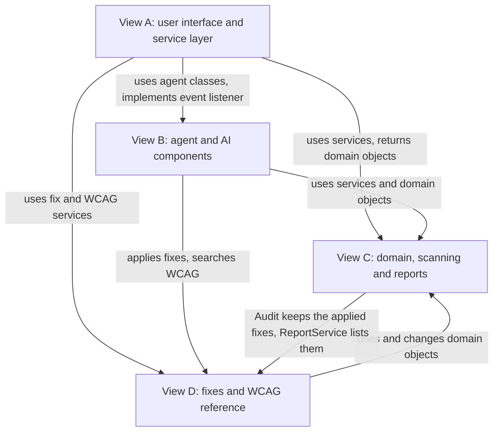

| From (view) | Relationship | To (view) |
|---|---|---|
| `AccessFixFacade` (A) | uses | `AgentController`, `ApprovalGate`, `IssueAssistant`, `MemoryManager` (B) |
| `AccessFixFacade` (A) | sets the mode of | `AgentSession` to `AskMode`, `PlanMode` or `FixMode` (B) |
| `AccessFixFacade` (A) | uses | `SnapshotService`, `RuleEngine`, `ReportService`, `AuditRepository` (C) |
| `AccessFixFacade` (A) | uses | `FixService`, `WcagKnowledgeBase` (D) |
| `AccessFixFacade`, `RestApiController` (A) | return | `Audit`, `ScanResult`, `RemediationPlan` (C) |
| `SseEventStream`, `ConsoleEventPrinter` (A) | implement | `AgentEventListener` (B) |
| `RestApiController` (A) | subscribes each new `SseEventStream` through | `AgentEventPublisher` (B) |
| `CliApp` (A) | subscribes `ConsoleEventPrinter` through | `AgentEventPublisher` (B) |
| `ApprovalGate` (B) | previews and applies fixes through | `FixService` (D) |
| `SearchWcagTool` (B) | searches | `WcagKnowledgeBase` (D) |
| `IssueAssistant` (B) | looks up criteria in | `WcagKnowledgeBase` (D) |
| `IssueAssistant` (B) | reads | `Issue`, `PageSnapshot` (C) |
| `SubmitPlanTool` (B) | validates with | `RemediationPlan` (C) |
| `MemoryManager` (B) | stores decisions, failure counts and escalations through | `AuditRepository` (C) |
| `Tool` implementations, such as `ProposeFixTool` (B) | read the audit (latest scan, escalations and failure counts) through | `AuditRepository` (C) |
| `FixService` (D) | uses | `RuleEngine`, `AuditRepository` (C) |
| `FixService` (D) | updates, and returns | `Audit`, `ScanResult` (C) |
| `FixCommand` (D) | changes | `PageSnapshot` (C) |
| `Audit` (C) | keeps the applied fixes, 0..*, as | `FixCommand` (D) |
| `ReportService` (C) | lists the verified fixes, read from the audit, as | `FixCommand` (D) |

#### View A: user interface and service layer

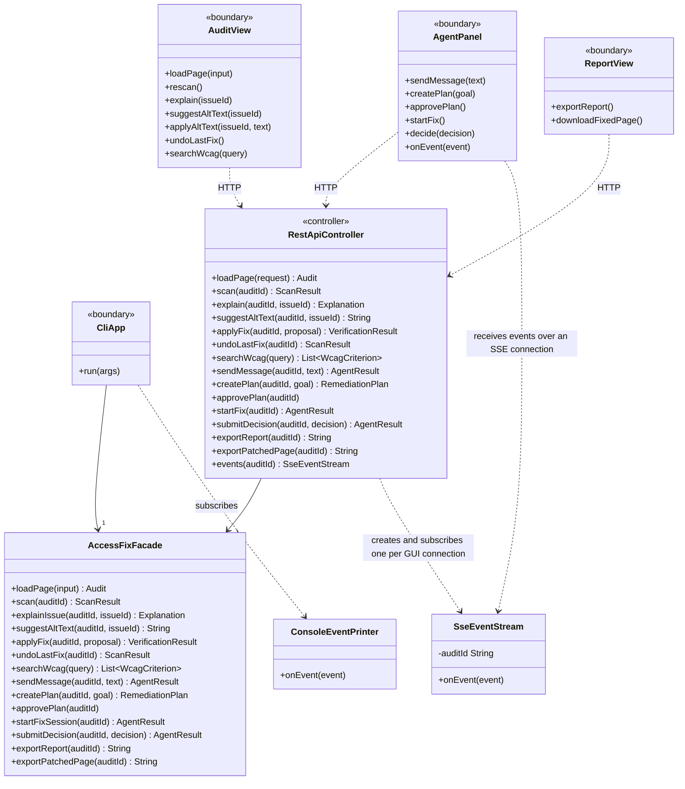

**Text description.** The three React views call `RestApiController` over HTTP. `RestApiController` and `CliApp` both call `AccessFixFacade`, which uses the classes in views B, C and D. `SseEventStream` (a backend class that sends events to the GUI over an SSE connection; `RestApiController.events()` creates and subscribes one for each `AgentPanel` connection, and it forwards only its own audit's events) and `ConsoleEventPrinter` (CLI) implement the `AgentEventListener` interface from view B, and receive agent events such as progress updates and fix proposals.

#### View B: agent and AI components

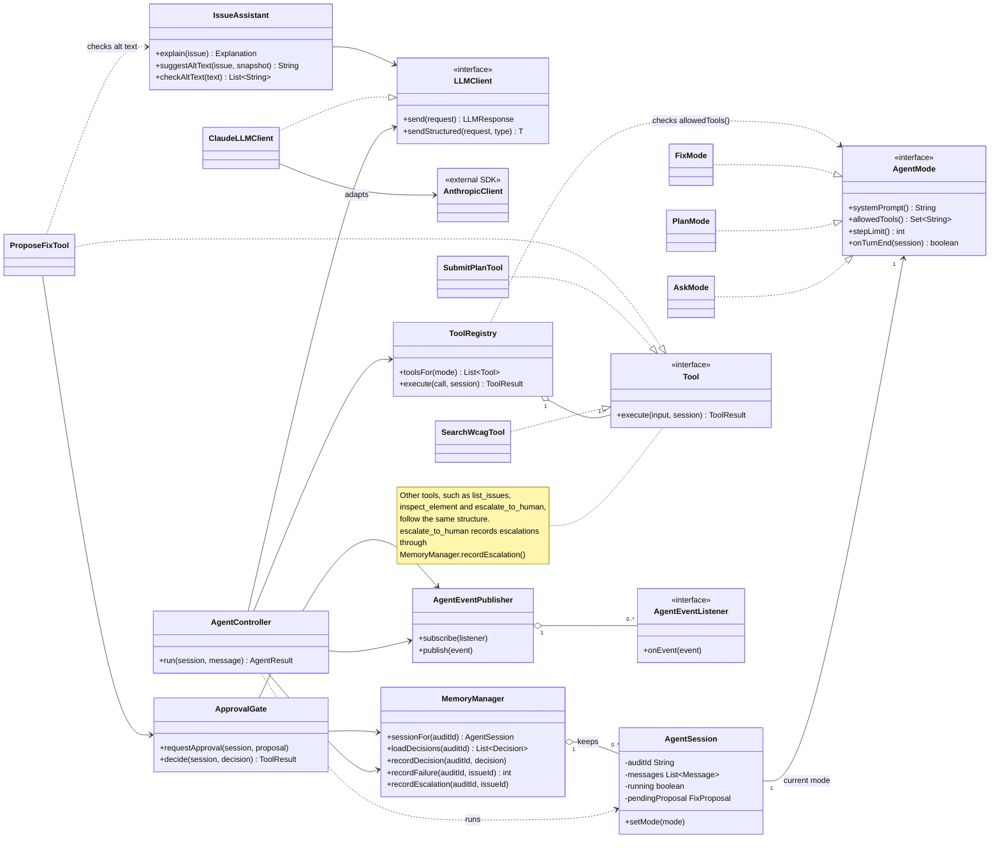

**Text description.**

- **Agent loop:** `AgentController` runs the loop for an `AgentSession`. Each session holds its own current `AgentMode`, which supplies the instructions, the allowed tools, the step limit and when a run stops. For example, `PlanMode` stops the run when the latest tool result in the session's messages accepted a plan. The session also records whether a run is in progress; that, or a pending proposal, makes the audit busy.
- **Model access:** `ClaudeLLMClient` wraps the Anthropic SDK behind `LLMClient`.
- **Tools:** `ToolRegistry` gives each mode its tools and checks every call.
- **Approval:** `ProposeFixTool` hands proposals to `ApprovalGate`, and `FixMode` pauses the run. When the user decides, `ApprovalGate` applies the fix or records the rejection. It records each failed fix through `MemoryManager`, and after a second failed fix on the same issue it records the issue as escalated.
- **Single requests:** `IssueAssistant` makes the one-off requests for explanations and alt text. Its `checkAltText()` is also used by `ProposeFixTool`, so agent-written alt text gets the same checks.
- **Events:** `AgentController` and `ApprovalGate` publish events through `AgentEventPublisher` to any `AgentEventListener`, without knowing whether the GUI or the CLI is listening.

#### View C: domain, scanning and reports

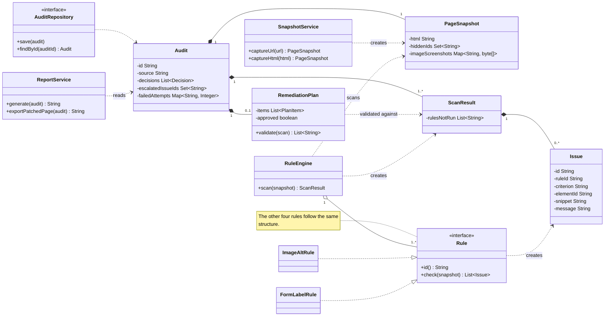

**Text description.**

- **Audit:** holds the page's snapshot, its scans (each made up of `Issue`s), the plan, the applied fixes (view D), the user's decisions, the number of failed fixes for each issue and the IDs of escalated issues.
- **Issue IDs:** `SnapshotService` gives every element a stable ID attribute. An issue's ID is its rule plus that element ID, so verification, the retry limit, the plan and escalations all match issues across scans.
- **RuleEngine:** runs each `Rule` on the stored `PageSnapshot` and creates a `ScanResult`. Rules read only the snapshot, so the same snapshot always gives the same issues.
- **ReportService:** builds the report and exports the fixed page, with the stable ID attributes removed.
- **AuditRepository:** stores audits.

#### View D: fixes and WCAG reference

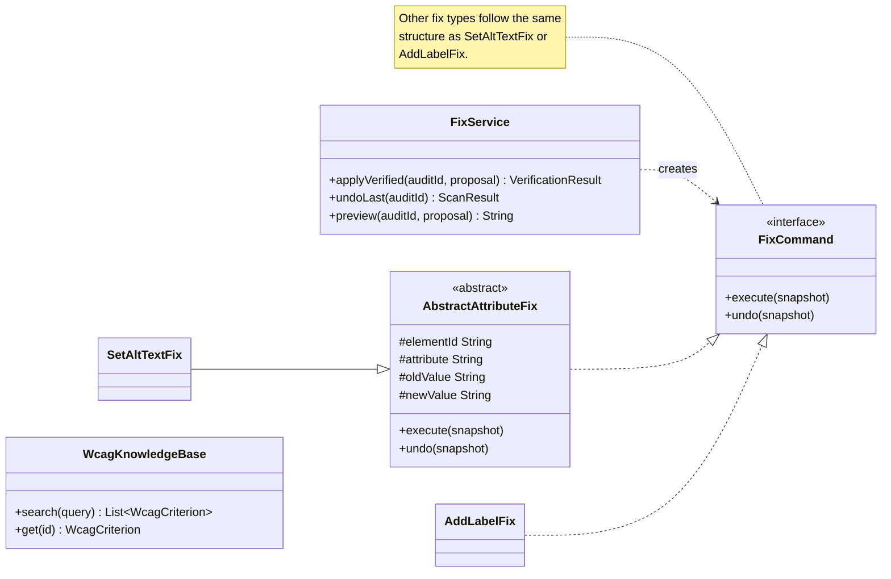

**Text description.**

- **FixService:** checks that the fix type is allowed and the issue is in the latest scan, for the user's own fixes too. It turns the proposal into a `FixCommand`, applies it, re-scans the page with `RuleEngine` (view C), and undoes the fix if verification fails. It can also undo the most recent fix.
- **FixCommand:** a fix that can execute and undo itself on the `PageSnapshot` (view C). `AbstractAttributeFix` shares that logic for fixes that change one attribute.
- **WcagKnowledgeBase:** loads the WCAG entries from a data file shipped with the application when it starts, and searches them for users and for the agent by matching the query's words.

#### Data types used in method signatures

These small data classes appear only as attribute, parameter or return types, so they aren't drawn as separate boxes.

| Type | What it holds |
|---|---|
| `Decision` | The user's answer to a fix proposal: approve, or reject with a reason, together with the proposal it answers. Only rejections are stored in `Audit.decisions` and given to the agent. |
| `FixProposal` | A proposed fix: the issue, the `FixType` and its values. |
| `FixType` | One of the five fix types, and the rules it can fix (F08). Plan validation, `ProposeFixTool` and `FixService` all check fixes against it. |
| `Message` | One turn of the conversation: the user's text, the model's reply, or a tool result. |
| `LLMResponse` | The model's reply: its text and any tool calls. |
| `ToolResult` | A tool's output, or an error, which is sent back to the model. |
| `AgentResult` | The agent's final answer for a run, the plan if one was produced, whether a fix is waiting for approval, and, when a fix session ends, the issue counts from the latest scan. |
| `Explanation` | A structured explanation: what is wrong, who is affected, the WCAG criterion and how to fix it. |
| `VerificationResult` | Whether a fix was kept or rolled back, and why. |
| `PlanItem` | One plan entry: an issue, its priority, a reason and a `FixType` (or manual). |
| `WcagCriterion` | One knowledge base entry: number, title, level, summary, who the criterion helps, and W3C link. |

#### Design patterns

| Pattern | Problem it addresses | Classes and roles | Why it is appropriate | What would be harder without it |
|---|---|---|---|---|
| Strategy | The scan must run several different checks, and new checks will be added. | `RuleEngine` (context), `Rule` (strategy), `ImageAltRule`, `FormLabelRule` and the other rules (concrete strategies). | Each rule is a separate algorithm with the same input and output. | `RuleEngine` would be one large method with a branch per rule, and rules couldn't be tested separately. |
| Command | Fixes must be applied, undone automatically when verification fails, and undone later by the user. | `FixCommand` (command), `SetAltTextFix` and `AddLabelFix` (concrete commands), `FixService` (invoker), `PageSnapshot` (receiver), `Audit` (keeps the applied fixes as history). | Each fix knows how to execute and undo itself, so apply, rollback and undo all work the same way. | Undo would need separate code for each fix type. |
| State | The agent loop must behave differently in Ask, Plan and Fix modes, and the mode changes at run time. | `AgentSession` (context), `AgentMode` (state), `AskMode`, `PlanMode`, `FixMode` (concrete states). | The mode decides the instructions, the tools, the step limit and when a run stops. `FixMode` pauses the run while a fix waits for approval, and `PlanMode` stops it once a valid plan is submitted. Each session keeps its own mode. The facade sets the mode when the user switches modes, which the State pattern allows. | `AgentController` would need mode checks in every method, and sessions could overwrite each other's mode. |
| Observer | Agent output and fix proposals must reach the browser or the terminal without the agent knowing which one is in use. | `AgentEventPublisher` (subject), `AgentEventListener` (observer), `SseEventStream` and `ConsoleEventPrinter` (concrete observers). | One event source has a changing set of receivers. | The agent core would depend directly on the web layer and the console. |
| Adapter | The agent needs a simple interface to the model, but the Anthropic SDK has its own types. | `LLMClient` (target), `ClaudeLLMClient` (adapter), `AnthropicClient` (adaptee). | Only `ClaudeLLMClient` depends on the SDK. | SDK types would spread through the agent code, and tests couldn't replace the model with a fake. |
| Facade | The GUI and CLI need the same operations, and each one involves several subsystems. | `AccessFixFacade` (facade), `RestApiController` and `CliApp` (clients), the services in views B, C and D (subsystems). | Both interfaces get one simple entry point and behave the same. | Each interface would coordinate the subsystems itself, duplicating logic. |

#### Important design decisions

- **The rules decide, and the AI proposes.** Only `RuleEngine` and `FixService` decide whether an issue exists and whether a fix is kept, so these decisions stay deterministic and testable (separation of concerns).
- **All work uses a stored snapshot.** Results are repeatable, and the live site is never changed.
- **The core depends on interfaces.** The core uses `LLMClient`, `Tool`, `Rule`, `FixCommand` and `AuditRepository`, not concrete classes (dependency inversion, low coupling), so tests can use fakes.
- **Limits are enforced in code.** `ToolRegistry` and `ProposeFixTool` check every tool call and fix, rather than relying on the prompt. A proposal pauses the run instead of blocking a thread, so the GUI and the CLI handle approval the same way.

### 2.2 Use-case diagram and use-case descriptions

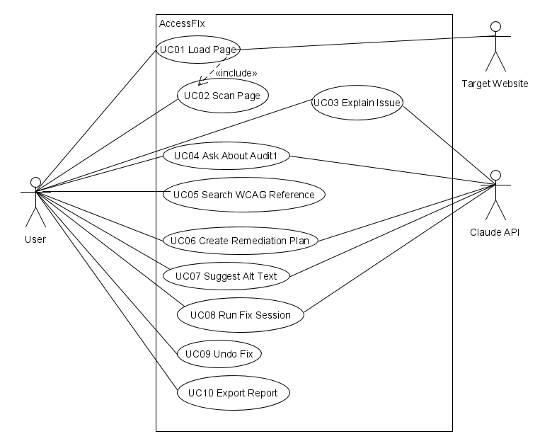

**Text description.**

- **Primary actor:** the User, who is linked to all 10 use cases.
- **Secondary actors:**
  - the Claude API, used by UC03, UC04, UC06, UC07 and UC08;
  - the Target Website, used by UC01.
- **Include relationship:** UC01 Load Page includes UC02 Scan Page.

#### UC01: Load Page

- **Actors:** User; Target Website.
- **Goal:** Create an audit from a web page.
- **Preconditions:** The application is running.
- **Trigger:** The User enters a URL or uploads an HTML file and selects **Load page**.
- **Main success scenario:**
  1. The system validates the input.
  2. The system loads the page and stores a snapshot.
  3. The system scans the page (UC02).
  4. The system shows the issues.
- **Alternative/exception flows:**
  - 1a. Invalid URL: an error is shown.
  - 2a. Site can't be reached, or times out: the error is shown with **Retry**.
- **Postconditions:** A saved audit with a snapshot and a scan.
- **Related features:** F01, F02.

#### UC02: Scan Page

- **Actors:** User.
- **Goal:** Find accessibility issues in a snapshot.
- **Preconditions:** An audit with a snapshot exists.
- **Trigger:** A page is loaded, or the User selects **Re-scan**.
- **Main success scenario:**
  1. The system runs each rule.
  2. The system saves the scan result.
  3. The system shows the issue list.
- **Alternative/exception flows:**
  - 1a. A rule fails: it is marked "not run", and the scan continues.
  - 3a. No issues found: the system says so and reminds the User that manual testing is still needed.
- **Postconditions:** A saved scan result.
- **Related features:** F02.

#### UC03: Explain Issue

- **Actors:** User; Claude API.
- **Goal:** Understand an issue in plain language.
- **Preconditions:** A scan result exists.
- **Trigger:** The User selects **Explain** on an issue.
- **Main success scenario:**
  1. The system gets the WCAG entry.
  2. The system asks Claude for a structured explanation.
  3. The system checks the result.
  4. The system shows the explanation.
- **Alternative/exception flows:**
  - 2a. The API fails or returns an invalid result: the issue's rule message is shown.
  - 3a. The explanation doesn't name the issue's criterion: the issue's rule message is shown.
- **Postconditions:** The explanation is shown.
- **Related features:** F03.

#### UC04: Ask About Audit

- **Actors:** User; Claude API.
- **Goal:** Get an answer to a question about the audit.
- **Preconditions:** A scan result exists.
- **Trigger:** The User sends a question in Ask mode.
- **Main success scenario:**
  1. The agent calls read-only tools as needed.
  2. The agent answers.
- **Alternative/exception flows:**
  - 1a. The audit is busy: the question is refused.
  - 1b. The agent asks for a tool that isn't allowed: an error result is returned to it.
  - 1c. The step limit is reached: the agent says what it couldn't check.
  - 1d. The Claude API fails: an error is shown with **Retry**.
  - 2a. The User asks for a change: the agent says changes are made in Fix mode.
- **Postconditions:** The answer is shown.
- **Related features:** F04, F05, F11.

#### UC05: Search WCAG Reference

- **Actors:** User.
- **Goal:** Find WCAG success criteria.
- **Preconditions:** The knowledge base is loaded.
- **Trigger:** The User enters a search query.
- **Main success scenario:**
  1. The system searches the knowledge base.
  2. The system shows the matching entries.
- **Alternative/exception flows:**
  - 1a. No matches: an empty result is shown.
- **Postconditions:** None.
- **Related features:** F05.

#### UC06: Create Remediation Plan

- **Actors:** User; Claude API.
- **Goal:** Get an approved, ranked fix plan.
- **Preconditions:** A scan result with open issues exists.
- **Trigger:** The User selects **Create plan**.
- **Main success scenario:**
  1. The agent inspects the issues and submits a plan.
  2. The system validates the plan.
  3. The User approves it.
- **Alternative/exception flows:**
  - 1a. The audit is busy: the request is refused.
  - 1b. The Claude API fails: an error is shown with **Retry**.
  - 2a. The plan is invalid: the errors go back to the agent, which can resubmit until the step limit; then an error is shown with **Retry**.
  - 3a. The User doesn't approve: they can create a new plan.
- **Postconditions:** An approved plan is saved.
- **Related features:** F06, F11.

#### UC07: Suggest Alt Text

- **Actors:** User; Claude API.
- **Goal:** Get and apply alt text for an image.
- **Preconditions:** A scan reports missing alt text.
- **Trigger:** The User selects **Suggest alt text**.
- **Main success scenario:**
  1. Claude suggests an alt text from the image's screenshot and context.
  2. The system checks the suggestion.
  3. The User edits it if needed and selects **Apply**.
  4. The system applies and verifies the fix.
- **Alternative/exception flows:**
  - 1a. The image wasn't rendered, so there is no screenshot: no suggestion is made, and the User writes the alt text.
  - 1b. The Claude API fails: the User is told and writes the alt text.
  - 2a. The suggestion fails the checks: the User is told and writes the alt text.
  - 3a. The audit is busy: applying is refused.
  - 4a. Verification fails: the fix is undone.
- **Postconditions:** The alt text is applied and verified, or the page is unchanged.
- **Related features:** F07, F09.

#### UC08: Run Fix Session

- **Actors:** User; Claude API.
- **Goal:** Have the agent fix issues, with the User approving each fix.
- **Preconditions:** An approved plan exists.
- **Trigger:** The User selects **Start** in Fix mode.
- **Main success scenario:**
  1. The system records the plan items marked "manual" as escalated.
  2. The agent proposes a fix, and its run pauses.
  3. The User reviews the diff and approves it.
  4. The system applies and verifies the fix.
  5. The agent continues with the next issue.
  6. The system shows the final counts.
- **Alternative/exception flows:**
  - 1a. The audit is busy: the request is refused.
  - 2a. The fix type isn't allowed, the alt text fails the F07 checks, the issue isn't in the latest scan or is already escalated, or the retry limit is reached: the fix is refused.
  - 2b. The agent can't fix an issue: instead of proposing a fix, it escalates the issue with `escalate_to_human`, and the issue is recorded as escalated.
  - 3a. The User rejects the fix: the decision is remembered and sent to the agent.
  - 4a. Verification fails: the fix is undone. After a second failure on the same issue, the issue is recorded as escalated.
  - *a. At any step, the Claude API fails: the run stops, verified fixes are kept, and the User can start the session again.
  - *b. At any step, the step limit is reached: the session stops and shows what is left.
- **Postconditions:** Verified fixes are applied, and escalated issues, including plan items marked "manual", are marked.
- **Related features:** F08, F09, F11.

#### UC09: Undo Fix

- **Actors:** User.
- **Goal:** Reverse the most recent fix.
- **Preconditions:** An audit exists.
- **Trigger:** The User selects **Undo**.
- **Main success scenario:**
  1. The system undoes the most recent fix.
  2. The system re-scans the page.
  3. The system shows the updated issues.
- **Alternative/exception flows:**
  - 1a. No fixes have been applied: there is nothing to undo.
  - 1b. The audit is busy: undo is refused.
- **Postconditions:** The page is restored to its state before that fix.
- **Related features:** F09.

#### UC10: Export Report

- **Actors:** User.
- **Goal:** Get a report and the fixed page.
- **Preconditions:** A scan result exists.
- **Trigger:** The User selects **Export report** or **Download fixed page**.
- **Main success scenario:**
  1. The system builds the requested file: the Markdown report or the fixed page.
  2. The User downloads it.
- **Alternative/exception flows:**
  - 1a. No fixes have been applied yet: the report lists no fixes, and shows the starting issues and any escalated issues.
- **Postconditions:** The report or the fixed page is downloaded.
- **Related features:** F10.

### 2.3 Sequence diagrams

The diagrams show the GUI. The facade loads the audit with `AuditRepository.findById()` whenever it needs it; SD07 shows this, and the other diagrams leave it out. With the CLI, `CliApp` replaces the React view and `RestApiController`, `ConsoleEventPrinter` receives the events, and fix decisions are typed at the prompt. While the audit is busy, the facade refuses agent requests, undo and applying alt text for that audit. The GUI's event connection is opened and subscribed at the start of SD05. SD03 shows this check, SD04 and SD05 refer to it, and SD02 and SD07 leave it out. The decision in SD06 isn't refused, because it is what the audit is waiting for.

#### SD01: Load and scan page

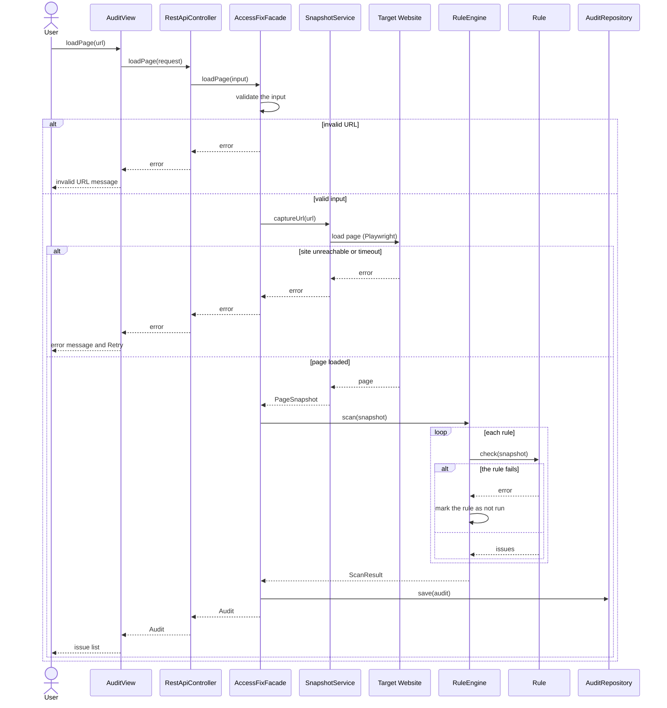

**Text description.** The facade validates the input, captures the page with `SnapshotService`, then scans it with `RuleEngine`, which calls `check()` on each rule and marks any rule that fails as not run. If the URL is invalid or loading fails, an error is shown. For an HTML file, `captureHtml(html)` is used instead of loading a URL. **Re-scan** (`rescan()` → `scan(auditId)`) runs the same steps from `RuleEngine.scan()` onwards.

#### SD02: Explain issue and suggest alt text

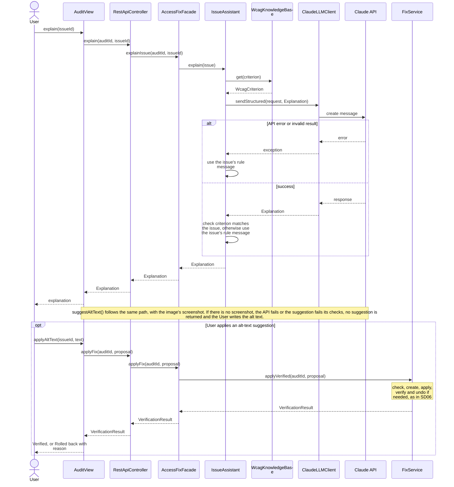

**Text description.** `IssueAssistant` gets the WCAG entry, asks Claude for a structured explanation and checks it. If the call fails, it falls back to the issue's rule message. Alt-text suggestions follow the same path, with the image's screenshot included. If there is no screenshot, the call fails or the suggestion fails its checks, no suggestion is returned and the User writes the alt text. An applied suggestion goes through `FixService.applyVerified()`.

#### SD03: Agent loop (Ask mode)

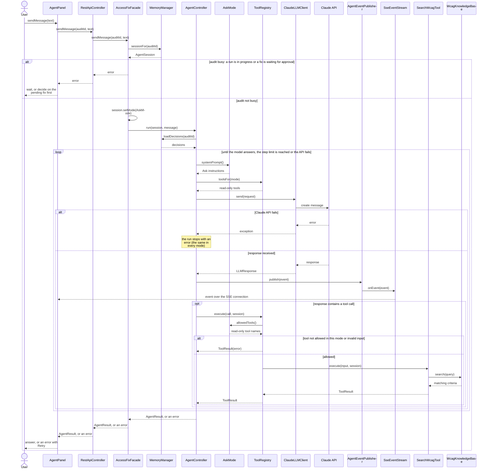

**Text description.** This is the agent loop all three modes share. The facade gets the audit's session, refuses the request if the audit is busy, and sets its mode. If the Claude API fails, the run stops with an error. The controller loads the user's decisions, then gets the mode's instructions and tools, calls Claude and publishes events to the GUI. It sends each tool call to `ToolRegistry`, which rejects any tool the mode doesn't allow.

#### SD04: Create remediation plan

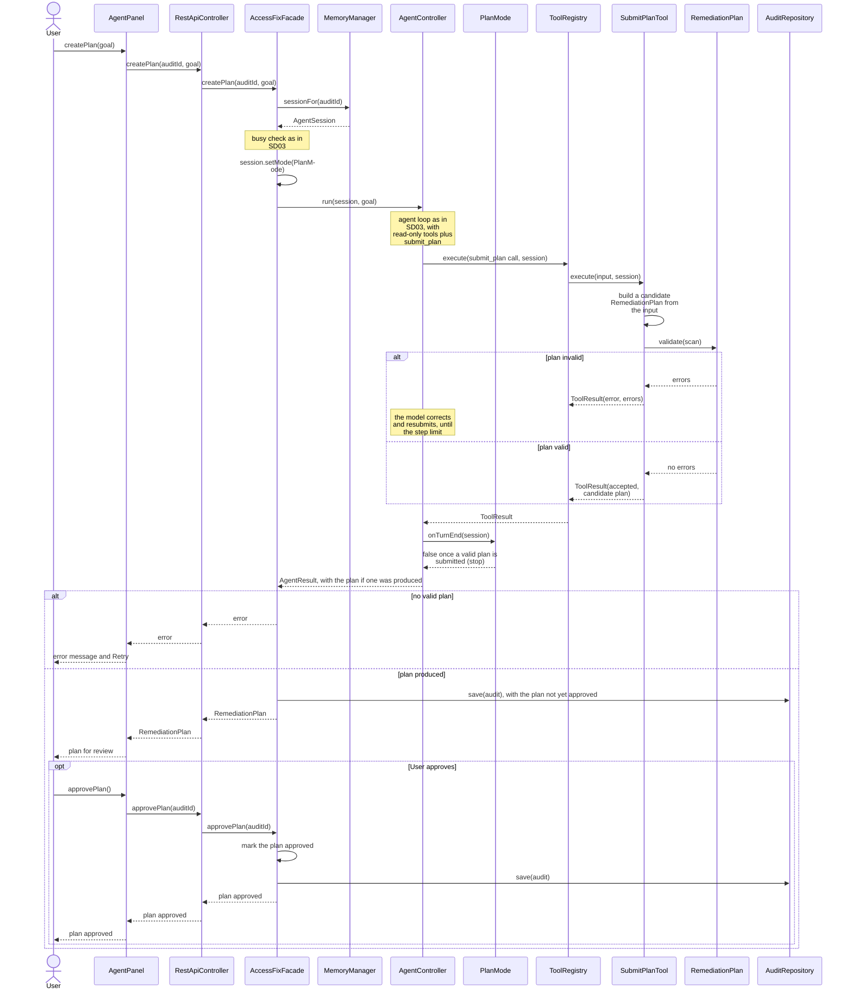

**Text description.** After the busy check, the facade sets the session to `PlanMode` and runs the agent loop. `SubmitPlanTool` validates the submitted plan, and an invalid plan's errors go back to the model. `PlanMode.onTurnEnd()` stops the run once a valid plan is submitted. If no valid plan was produced, an error is shown. Otherwise, the plan is saved, not yet approved, and shown to the User. When the User approves it, it is marked approved and saved again.

#### SD05: Fix session (proposal)

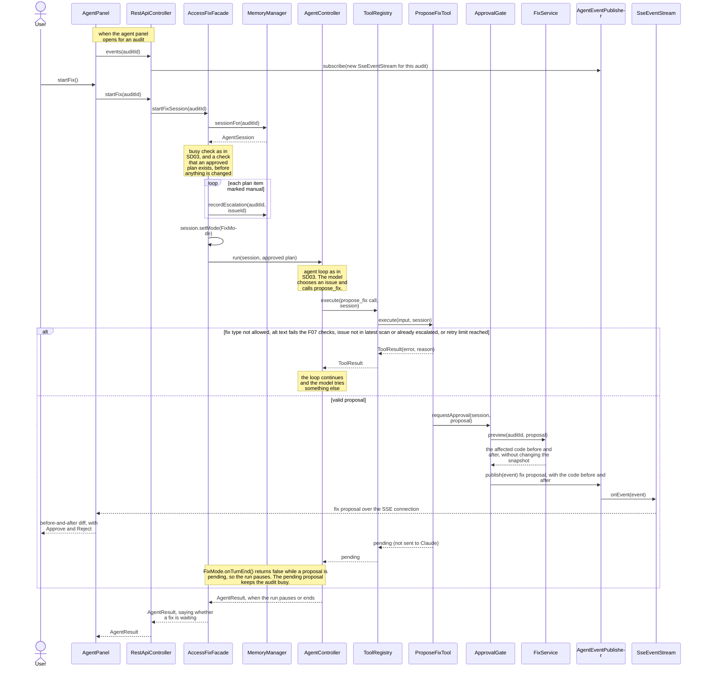

**Text description.**

1. After the busy check and a check that an approved plan exists, the facade records the plan items marked manual as escalated, sets the session to `FixMode` and runs the agent loop.
2. `ProposeFixTool` refuses a proposal if the fix type isn't allowed, its alt text fails the F07 checks, the issue isn't in the latest scan or is already escalated, or the retry limit is reached.
3. Otherwise, `ApprovalGate` stores and publishes the proposal, and the run pauses. The tool call stays open until the User decides (SD06), and the decision becomes its result. Any other tool calls in the same response are run first, and their results are sent back with the decision.

Escalation (`escalate_to_human`) follows the normal tool path. If the model stops calling tools or the step limit is reached, the session ends with a summary, as at the end of SD06.

#### SD06: Fix decision and verification

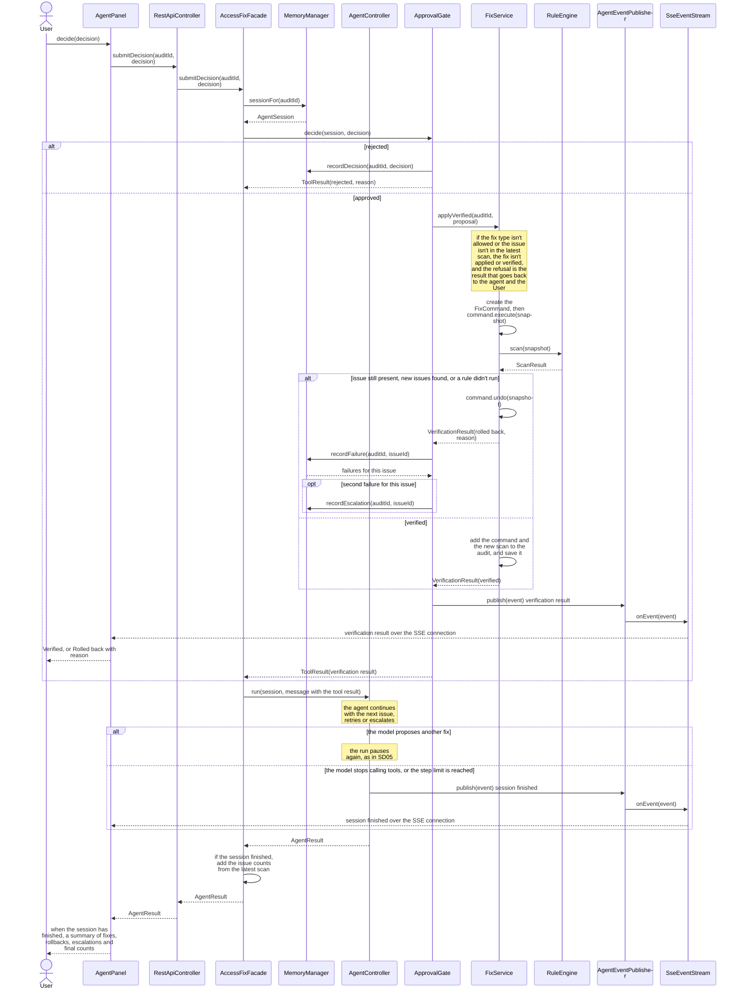

**Text description.**

1. When the User decides, the facade gets the session and calls `ApprovalGate.decide()`.
2. A rejection is recorded as a `Decision`. An approval goes to `FixService`, which checks the fix, applies it and re-scans the page. It undoes the fix if verification fails, or saves the fix and the new scan with the audit. The result is published, so the User sees "Verified" or "Rolled back" with the reason. `ApprovalGate` records each failed fix through `MemoryManager`, and after a second failed fix on the same issue it records the issue as escalated.
3. The result goes back to the agent as the tool's result, and the run continues. If the agent proposes another fix, the run pauses again as in SD05. When the session ends, the facade adds the issue counts from the latest scan to the `AgentResult`, and the User sees the summary.

#### SD07: Undo, export and search

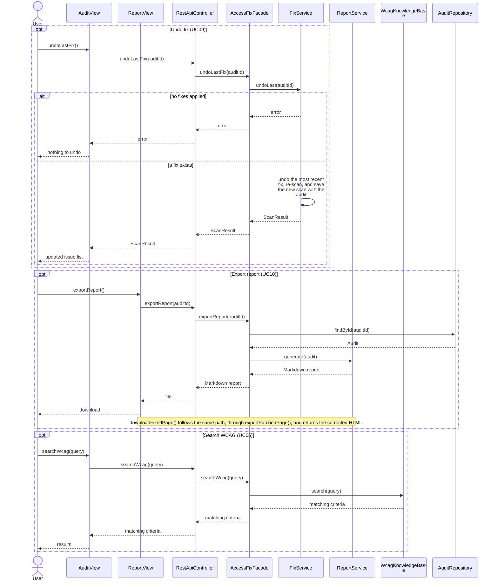

**Text description.** These operations don't use the AI model. Each goes from a view, through `RestApiController` and `AccessFixFacade`, to one service:

- `FixService.undoLast()`;
- `ReportService.generate()` for the report, or `ReportService.exportPatchedPage()` for the fixed page;
- `WcagKnowledgeBase.search()`.

---

## Task 3: Feature-to-design traceability

Every GUI request reaches `AccessFixFacade` through `RestApiController`, and every CLI request through `CliApp`, so these two classes aren't repeated in each row.

| Feature | Description | Type | Related use case | Classes | Key methods | Sequence diagram | Design pattern(s) |
|---|---|---|---|---|---|---|---|
| F01 | Load a page and store a snapshot | Deterministic | UC01 Load Page | AuditView, AccessFixFacade, SnapshotService, Audit, PageSnapshot, AuditRepository | loadPage(), captureUrl(), captureHtml(), save() | SD01 | Facade |
| F02 | Scan the snapshot with the rules | Deterministic | UC02 Scan Page, UC01 Load Page | AuditView, AccessFixFacade, RuleEngine, Rule, PageSnapshot, ScanResult, Issue, AuditRepository | scan(), check(), save() | SD01 | Strategy, Facade |
| F03 | Explain an issue in plain language | Hybrid | UC03 Explain Issue | AuditView, AccessFixFacade, IssueAssistant, WcagKnowledgeBase, LLMClient, ClaudeLLMClient | explainIssue(), explain(), get(), sendStructured() | SD02 | Adapter, Facade |
| F04 | Answer questions about the audit | AI-based | UC04 Ask About Audit | AgentPanel, AccessFixFacade, MemoryManager, AgentController, AgentSession, AskMode, ToolRegistry, Tool, ClaudeLLMClient, AgentEventPublisher | sendMessage(), sessionFor(), setMode(), run(), toolsFor(), execute(), send(), publish() | SD03 | State, Adapter, Observer, Facade |
| F05 | Search the WCAG knowledge base | Hybrid | UC05 Search WCAG Reference, UC04 Ask About Audit | AuditView, AccessFixFacade, WcagKnowledgeBase, SearchWcagTool | searchWcag(), search(), execute() | SD03, SD07 | Facade |
| F06 | Create and approve a remediation plan | Hybrid | UC06 Create Remediation Plan | AgentPanel, AccessFixFacade, MemoryManager, AgentController, AgentSession, PlanMode, ToolRegistry, SubmitPlanTool, RemediationPlan, AuditRepository | createPlan(), sessionFor(), setMode(), run(), validate(), onTurnEnd(), approvePlan(), save() | SD04 | State, Facade |
| F07 | Suggest and apply alt text | AI-based | UC07 Suggest Alt Text | AuditView, AccessFixFacade, IssueAssistant, ClaudeLLMClient, FixService | suggestAltText(), checkAltText(), sendStructured(), applyFix(), applyVerified() | SD02 | Adapter, Command, Facade |
| F08 | Agent proposes fixes, and the user approves each one | Hybrid | UC08 Run Fix Session | AgentPanel, AccessFixFacade, MemoryManager, AgentController, AgentSession, FixMode, ToolRegistry, ProposeFixTool, ApprovalGate, AgentEventPublisher, FixService | startFixSession(), sessionFor(), recordEscalation(), execute(), requestApproval(), preview(), submitDecision(), decide(), applyVerified(), recordFailure(), run() | SD05, SD06 | State, Observer, Command, Facade |
| F09 | Verify each fix, and undo the most recent one | Deterministic | UC09 Undo Fix, UC08 Run Fix Session, UC07 Suggest Alt Text | FixService, FixCommand, AbstractAttributeFix, RuleEngine, Audit, AuditRepository | applyVerified(), execute(), scan(), undo(), undoLast(), save() | SD06, SD07 | Command |
| F10 | Export a report and the fixed page | Deterministic | UC10 Export Report | ReportView, AccessFixFacade, AuditRepository, ReportService | exportReport(), findById(), generate(), exportPatchedPage() | SD07 | Facade |
| F11 | Remember rejected fixes | Hybrid | UC08 Run Fix Session, UC04 Ask About Audit, UC06 Create Remediation Plan | ApprovalGate, MemoryManager, Audit, AuditRepository, AgentController | decide(), recordDecision(), loadDecisions(), save(), run() | SD06, SD03 | None |

---

## Task 4: How each feature is realized

### F01: Page loading and snapshot

- **Related use case:** UC01 Load Page
- **Related sequence diagram:** SD01 Load and scan page

**Classes involved:**
- `AuditView`: collects the URL or HTML file.
- `RestApiController`: receives the request.
- `AccessFixFacade`: coordinates loading.
- `SnapshotService`: loads the page and builds the snapshot.
- `PageSnapshot`: holds the HTML, the hidden elements and the image screenshots.
- `Audit`: groups the snapshot with its scans and fixes.
- `AuditRepository`: saves the audit.

**Important methods:** `AuditView.loadPage()`, `RestApiController.loadPage()`, `AccessFixFacade.loadPage()`, `SnapshotService.captureUrl()`, `SnapshotService.captureHtml()`, `AuditRepository.save()`

**Execution:** When the user selects **Load page**, `AuditView.loadPage()` sends the input to `RestApiController.loadPage()`, which calls `AccessFixFacade.loadPage()`. The facade calls `SnapshotService.captureUrl()` (or `captureHtml()` for a file), which loads the page with Playwright and returns a `PageSnapshot`. The facade puts the snapshot in a new `Audit`, runs the scan (F02) and saves the audit with `AuditRepository.save()`.

### F02: Accessibility scan

- **Related use cases:** UC02 Scan Page, UC01 Load Page
- **Related sequence diagram:** SD01 Load and scan page

**Classes involved:**
- `AuditView`: shows the issues, and has **Re-scan**.
- `AccessFixFacade`: starts the scan.
- `RuleEngine`: runs the rules.
- `Rule`: one check, such as `ImageAltRule` or `FormLabelRule`.
- `PageSnapshot`: the input, including which elements are hidden.
- `ScanResult`: holds the issues.
- `Issue`: one problem found.
- `AuditRepository`: saves the scan result with the audit.

**Important methods:** `AccessFixFacade.scan()`, `RuleEngine.scan()`, `Rule.check()`, `AuditRepository.save()`

**Execution:** After a page loads, or when the user selects **Re-scan**, `AccessFixFacade.scan()` calls `RuleEngine.scan()` with the snapshot. The engine calls `check()` on each `Rule`. Rules skip the elements the snapshot records as hidden. Each rule returns `Issue` objects, which the engine sorts into a `ScanResult`. The facade adds it to the audit, saves it with `AuditRepository.save()` and returns it to `AuditView`.

### F03: Issue explanation

- **Related use case:** UC03 Explain Issue
- **Related sequence diagram:** SD02 Explain issue and suggest alt text

**Classes involved:**
- `AuditView`: sends the request.
- `AccessFixFacade`: passes the request on.
- `IssueAssistant`: builds the request and checks the result.
- `WcagKnowledgeBase`: supplies the WCAG criterion.
- `LLMClient` / `ClaudeLLMClient`: sends the request to Claude.

**Important methods:** `AuditView.explain()`, `AccessFixFacade.explainIssue()`, `IssueAssistant.explain()`, `WcagKnowledgeBase.get()`, `LLMClient.sendStructured()`

**Execution:** `AuditView.explain()` sends the issue through `RestApiController` to `AccessFixFacade.explainIssue()`. `IssueAssistant.explain()` gets the criterion with `WcagKnowledgeBase.get()` and asks Claude for an `Explanation` through `LLMClient.sendStructured()`. It checks that the explanation names the issue's criterion. If the call fails, it returns the issue's rule message instead.

### F04: Ask mode (questions about the audit)

- **Related use case:** UC04 Ask About Audit
- **Related sequence diagram:** SD03 Agent loop (Ask mode)

**Classes involved:**
- `AgentPanel`: the chat.
- `AccessFixFacade`: starts the run.
- `MemoryManager`: provides the audit's session and the user's decisions.
- `AgentSession`: holds the conversation and the current mode.
- `AgentController`: runs the agent loop.
- `AskMode`: supplies the instructions, and limits the agent to read-only tools.
- `ToolRegistry`: provides and runs the tools.
- `Tool`: one action, such as `SearchWcagTool`.
- `ClaudeLLMClient`: calls Claude.
- `AgentEventPublisher`: sends progress updates to the GUI.

**Important methods:** `AgentPanel.sendMessage()`, `AccessFixFacade.sendMessage()`, `MemoryManager.sessionFor()`, `AgentSession.setMode()`, `AgentController.run()`, `ToolRegistry.toolsFor()`, `ToolRegistry.execute()`, `LLMClient.send()`, `AgentEventPublisher.publish()`

**Execution:**
1. `AgentPanel.sendMessage()` reaches `AccessFixFacade.sendMessage()`. The facade gets the session with `MemoryManager.sessionFor()`, sets it to `AskMode` with `setMode()` and calls `AgentController.run()`. If the audit is busy, the question is refused first.
2. In each step, the controller:
   - gets `AskMode`'s instructions, and its read-only tools from `ToolRegistry.toolsFor()`;
   - calls Claude with `LLMClient.send()`;
   - sends a progress update with `AgentEventPublisher.publish()`.
3. Tool calls go to `ToolRegistry.execute()`, which rejects any tool Ask mode doesn't allow.

### F05: WCAG reference retrieval

- **Related use cases:** UC05 Search WCAG Reference, UC04 Ask About Audit
- **Related sequence diagrams:** SD07 Undo, export and search; SD03 Agent loop (Ask mode)

**Classes involved:**
- `AuditView`: the search box.
- `AccessFixFacade`: passes the search on.
- `WcagKnowledgeBase`: searches the entries.
- `SearchWcagTool`: lets the agent search.

**Important methods:** `AuditView.searchWcag()`, `AccessFixFacade.searchWcag()`, `WcagKnowledgeBase.search()`, `SearchWcagTool.execute()`

**Execution:** A user's search goes from `AuditView.searchWcag()` through the facade to `WcagKnowledgeBase.search()`, which returns the ranked entries. When the agent needs WCAG text, the agent loop runs `SearchWcagTool.execute()`, which calls the same `search()` and returns the entries to Claude.

### F06: Remediation plan (Plan mode)

- **Related use case:** UC06 Create Remediation Plan
- **Related sequence diagram:** SD04 Create remediation plan

**Classes involved:**
- `AgentPanel`: requests and approves the plan.
- `AccessFixFacade`: sets Plan mode, saves the plan and marks it approved.
- `MemoryManager`: provides the audit's session.
- `AgentSession`: holds the current mode.
- `AgentController`: runs the agent loop.
- `PlanMode`: supplies the plan instructions, and stops the run once a valid plan is submitted.
- `ToolRegistry`: runs `submit_plan`.
- `SubmitPlanTool`: receives the plan.
- `RemediationPlan`: the plan, which validates itself.
- `AuditRepository`: saves the plan.

**Important methods:** `AgentPanel.createPlan()`, `AccessFixFacade.createPlan()`, `MemoryManager.sessionFor()`, `AgentSession.setMode()`, `AgentController.run()`, `RemediationPlan.validate()`, `PlanMode.onTurnEnd()`, `AccessFixFacade.approvePlan()`, `AuditRepository.save()`

**Execution:**
1. `AccessFixFacade.createPlan()` refuses the request if the audit is busy. Otherwise it sets the session to `PlanMode` with `setMode()` and calls `run()`.
2. When Claude calls `submit_plan`, `ToolRegistry` runs `SubmitPlanTool`. The tool checks the plan with `RemediationPlan.validate()` and returns any errors to Claude.
3. `PlanMode.onTurnEnd()` stops the run once a valid plan is submitted, and the facade saves the plan, not yet approved, with `AuditRepository.save()`.
4. When the user approves the plan, `approvePlan()` marks it approved and saves it again.

### F07: Alt-text suggestions

- **Related use case:** UC07 Suggest Alt Text
- **Related sequence diagram:** SD02 Explain issue and suggest alt text

**Classes involved:**
- `AuditView`: requests a suggestion and applies it.
- `AccessFixFacade`: passes requests on.
- `IssueAssistant`: sends the screenshot to Claude and checks the suggestion.
- `ClaudeLLMClient`: calls Claude.
- `FixService`: applies the alt text.

**Important methods:** `AuditView.suggestAltText()`, `AccessFixFacade.suggestAltText()`, `IssueAssistant.suggestAltText()`, `IssueAssistant.checkAltText()`, `LLMClient.sendStructured()`, `AccessFixFacade.applyFix()`, `FixService.applyVerified()`

**Execution:** `AccessFixFacade.suggestAltText()` calls `IssueAssistant.suggestAltText()`. That method sends the image's screenshot and its surrounding text to Claude through `sendStructured()`, then checks the suggestion with `checkAltText()`. When the user applies it, `AuditView.applyAltText()` leads to `AccessFixFacade.applyFix()`, which refuses the request if the audit is busy and otherwise calls `FixService.applyVerified()` (F09).

### F08: Fix session with approval (Fix mode)

- **Related use case:** UC08 Run Fix Session
- **Related sequence diagrams:** SD05 Fix session (proposal); SD06 Fix decision and verification

**Classes involved:**
- `AgentPanel`: starts the session, shows each proposal and returns the user's decision.
- `AccessFixFacade`: starts the session and passes decisions on.
- `MemoryManager`: provides the audit's session, and records failed fixes and escalations.
- `AgentSession`: holds the current mode and the pending proposal.
- `AgentController`: runs the agent loop.
- `FixMode`: supplies the Fix instructions and tools, and pauses the run while a proposal is pending.
- `ToolRegistry`: runs `propose_fix`.
- `ProposeFixTool`: checks each proposal.
- `ApprovalGate`: stores the proposal, then handles the user's decision.
- `AgentEventPublisher`: sends proposals to the GUI.
- `FixService`: previews each proposal and applies approved fixes.

**Important methods:** `AccessFixFacade.startFixSession()`, `MemoryManager.sessionFor()`, `MemoryManager.recordEscalation()`, `ToolRegistry.execute()`, `ApprovalGate.requestApproval()`, `FixService.preview()`, `AccessFixFacade.submitDecision()`, `ApprovalGate.decide()`, `FixService.applyVerified()`, `MemoryManager.recordFailure()`, `AgentController.run()`

**Execution:**
1. `AccessFixFacade.startFixSession()` refuses the request if the audit is busy or no plan has been approved. Otherwise it records the plan's manual items as escalated with `MemoryManager.recordEscalation()`, sets the session to `FixMode`, and runs the agent loop with the approved plan as the first message.
2. When Claude calls `propose_fix`, `ToolRegistry.execute()` runs `ProposeFixTool`. The tool refuses a fix type that isn't allowed, alt text that fails `IssueAssistant.checkAltText()`, an issue that isn't in the latest scan or is already escalated, or an issue at its retry limit.
3. Otherwise, `ApprovalGate.requestApproval()` gets the affected code before and after the change from `FixService.preview()`, which tries the fix on a copy so the snapshot isn't changed. It stores the proposal and publishes it through `AgentEventPublisher`, so `AgentPanel` can show the diff. `FixMode` then pauses the run.
4. The user's choice reaches `ApprovalGate.decide()` through `AccessFixFacade.submitDecision()`. An approval goes to `FixService.applyVerified()`, and a rejection is recorded (F11). `ApprovalGate` records each failed fix with `MemoryManager.recordFailure()`, and after a second failed fix on the same issue it records the issue as escalated with `MemoryManager.recordEscalation()`.
5. The facade calls `AgentController.run()` again with the result as the tool's result, and Claude chooses the next step.

### F09: Fix verification and undo

- **Related use cases:** UC09 Undo Fix, UC08 Run Fix Session, UC07 Suggest Alt Text
- **Related sequence diagrams:** SD06 Fix decision and verification; SD07 Undo, export and search

**Classes involved:**
- `FixService`: applies, verifies and undoes fixes.
- `FixCommand`: a fix that can execute and undo itself, such as `SetAltTextFix`.
- `AbstractAttributeFix`: shares the execute and undo logic for fixes that change one attribute.
- `RuleEngine`: re-scans the page.
- `Audit`: keeps the applied fixes.
- `AuditRepository`: saves the audit.

**Important methods:** `FixService.applyVerified()`, `FixCommand.execute()`, `RuleEngine.scan()`, `FixCommand.undo()`, `FixService.undoLast()`, `AuditRepository.save()`

**Execution:**
1. `FixService.applyVerified()` checks the fix, turns the proposal into a `FixCommand` and calls `execute()` on the snapshot.
2. `RuleEngine.scan()` re-scans the page.
3. If the issue remains, new issues appear or a rule didn't run, `FixService` calls `undo()` on the command. Otherwise it adds the command and the new scan to the audit, and saves it with `AuditRepository.save()`.
4. `FixService.undoLast()` later undoes the most recent applied fix, re-scans and saves the new scan with the audit. The facade refuses undo while the audit is busy.

### F10: Report and fixed-page export

- **Related use case:** UC10 Export Report
- **Related sequence diagram:** SD07 Undo, export and search

**Classes involved:**
- `ReportView`: starts the export and downloads the files.
- `AccessFixFacade`: passes the request on.
- `AuditRepository`: loads the audit.
- `ReportService`: builds the report and the fixed page.

**Important methods:** `ReportView.exportReport()`, `AccessFixFacade.exportReport()`, `AuditRepository.findById()`, `ReportService.generate()`, `ReportService.exportPatchedPage()`

**Execution:** `ReportView.exportReport()` reaches `AccessFixFacade.exportReport()`, which loads the audit with `findById()`. `ReportService.generate()` then builds the Markdown report. **Download fixed page** calls `ReportService.exportPatchedPage()`, which returns the snapshot's current HTML without the stable ID attributes.

### F11: Memory of rejected fixes

- **Related use cases:** UC08 Run Fix Session, UC04 Ask About Audit, UC06 Create Remediation Plan
- **Related sequence diagrams:** SD06 Fix decision and verification; SD03 Agent loop (Ask mode)

**Classes involved:**
- `ApprovalGate`: records a rejection.
- `MemoryManager`: stores and loads decisions.
- `Audit`: holds the decisions.
- `AuditRepository`: persists them.
- `AgentController`: adds them to each request.

**Important methods:** `ApprovalGate.decide()`, `MemoryManager.recordDecision()`, `MemoryManager.loadDecisions()`, `AuditRepository.save()`, `AgentController.run()`

**Execution:** When the user rejects a fix, `ApprovalGate.decide()` calls `MemoryManager.recordDecision()`. That method adds the `Decision` to the `Audit` and saves it with `AuditRepository.save()`, so it survives a restart. At the start of every run, `AgentController.run()` calls `loadDecisions()` and includes the decisions in its request to Claude.
